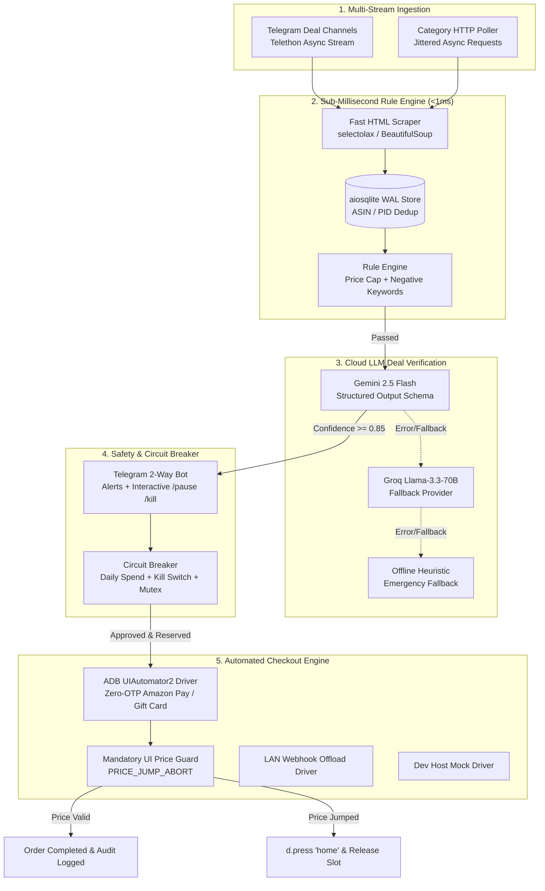

# PROJECT_CONTEXT.md — Flash-Hunter System Architecture & State

This document provides a comprehensive technical overview of **Flash-Hunter**, an autonomous flash-sale detection, LLM deal verification, and automated zero-OTP checkout system cross-developed on a Host Workstation and deployed to an edge Android TV board.

---

## 1. System Architecture & Topology

Flash-Hunter uses an asynchronous, decoupled pipeline designed for sub-millisecond local filtering, cloud LLM structured verification, and deterministic Android UI automation.



### Supported Execution Topologies
Controlled declaratively via [`config/settings.yaml`](config/settings.yaml:1) or `.env`:
1. **On-Board Standalone Mode (`EXECUTION_MODE=STANDALONE`, `ADB_TARGET=127.0.0.1:5555`):**
   The entire Python pipeline runs directly inside Native Termux on the Xiaomi Mi TV motherboard, driving the local ADB daemon directly.
2. **Remote LAN Controller Mode (`EXECUTION_MODE=REMOTE_LAN`, `ADB_TARGET=<MI_TV_IP>:5555`):**
   The Python pipeline runs on the host development machine, controlling the Mi TV board's UI remotely over LAN Wi-Fi ADB.
3. **Host Dev / Mock Mode (`EXECUTION_MODE=MOCK`, `DRY_RUN=true`):**
   Runs 100% offline on the host workstation with simulated HTTP responses, mock ADB drivers, and mock LLM fixtures for unit testing.

---

## 2. Hardware Profile & Target Constraints

| Parameter | Specification | Impact on Codebase |
| :--- | :--- | :--- |
| **Target Board** | Xiaomi Mi TV Motherboard | Android TV 9 / 10 / 11 Leanback OS |
| **SoC / CPU** | Amlogic ARM64 Quad-Core Cortex-A53 | Multi-core compilation throttles memory |
| **Userland OS** | Native Termux (`armeabi-v7a` 32-bit userland) | Saves memory over 64-bit; requires `CARGO_BUILD_JOBS=1` and `ANDROID_API_LEVEL=24` |
| **Physical RAM** | 2048 MB (2.0 GB) Shared Video Memory | Target runtime RSS memory must stay **<200 MB** |
| **Process Watchdog** | [`scripts/start_hunter_termux.sh`](scripts/start_hunter_termux.sh:1) | Monitors `/proc/$PID/statm`; auto-restarts if RSS > 190 MB (`MAX_RSS_KB=194560`) |
| **Storage** | eMMC Flash (4GB to 8GB) | SQLite configured in `WAL` mode with `temp_store=MEMORY` and `synchronous=NORMAL` |
| **Power Management** | Android TV Doze / Display Standby | Requires `termux-wake-lock` and `dumpsys deviceidle whitelist` |

---

## 3. Active Category Filters & Declarative Rules

Configured in [`config/targets.yaml`](config/targets.yaml:1):

### 1. `high_end_laptops`
- **Name:** High-End Laptops (Gaming, Workstation, Ultrabook)
- **Budget Cap:** ₹10,000.00 INR
- **Min Discount:** 50.0%
- **Natural Language Spec:** Genuine premium high-performance laptops including gaming laptops (NVIDIA RTX 3060/4050/4060/4070/4080/4090 or AMD Radeon RX 6000/7000), mobile workstations, or premium ultrabooks (Intel Core i7/i9/Ultra 7/Ultra 9, AMD Ryzen 7/9/AI, Apple MacBook Air/Pro M1/M2/M3/M4 with at least 16GB RAM and 512GB/1TB NVMe SSD) from tier-1 brands (Apple, ASUS, Lenovo, Dell, HP, Acer, MSI).
- **Negative Keywords:** `celeron`, `pentium`, `athlon`, `chromebook`, `emmc`, `dual core`, `atom`, `skin`, `cover`, `sleeve`, `bag`, `backpack`, `charger`, `stand`, `cooling pad`, `cooler`, `keyboard cover`, `screen guard`, `dock`, `hub`, `dummy`, `refurbished`, `box only`, `spare part`, `motherboard only`, `screen only`, `battery only`.

### 2. `pc_components`
- **Name:** PC Components (GPU, CPU, NVMe SSD, DDR4/DDR5 RAM, Motherboard)
- **Budget Cap:** ₹15,000.00 INR
- **Min Discount:** 35.0%
- **Natural Language Spec:** Genuine internal PC computer hardware components including: NVMe M.2 SSDs (>=1TB PCIe Gen4/Gen3), DDR4/DDR5 RAM kits (>=16GB/32GB), dedicated Graphics Cards (NVIDIA RTX or AMD Radeon), Desktop CPUs (Intel Core i5/i7/i9 or AMD Ryzen 5/7/9), or 80+ Gold/Bronze Power Supplies from reputed brands.
- **Negative Keywords:** `laptop`, `notebook`, `macbook`, `desktop`, `prebuilt`, `smartphone`, `phone`, `tablet`, `thermal paste`, `thermal pad`, `screws`, `sata cable`, `fan splitter`, `rgb strip`, `mounting bracket`, `riser cable`, `extension cable`, `cooler bracket`, `dummy`, `heatsink only`, `enclosure only`, `case only`, `empty box`, `refurbished`, `renewed`.

### 3. `large_home_appliances`
- **Name:** Large Home Appliances (Washing Machine, Refrigerator, AC, Microwave, Smart TV)
- **Budget Cap:** ₹5,000.00 INR
- **Min Discount:** 60.0%
- **Natural Language Spec:** Genuine full-sized large major home appliances: Fully/Semi-Automatic Washing Machines, Frost-Free Refrigerators, Split/Window Air Conditioners, Microwave Ovens (>=20L), Dishwashers, or Smart LED/QLED Televisions (>=32 inch) from top manufacturers (LG, Samsung, Whirlpool, Bosch, IFB, Panasonic, Haier, Godrej, Voltas, Daikin, Sony, Mi).
- **Negative Keywords:** `cover`, `dust cover`, `stand`, `trolley`, `mat`, `refrigerator mat`, `fridge cover`, `washing machine cover`, `inlet pipe`, `drain pipe`, `ac cover`, `stabilizer only`, `voltage stabilizer`, `remote only`, `shelf`, `tray`, `filter only`, `descaling powder`, `detergent`, `wall mount bracket`, `spare part`, `refurbished`, `renewed`, `dummy`.

### 4. `flagship_smartphone`
- **Name:** Flagship / Upper Mid-Range Smartphone
- **Budget Cap:** ₹25,000.00 INR
- **Min Discount:** 30.0%
- **Natural Language Spec:** Genuine smartphone with at least 8GB RAM and 128GB/256GB storage, modern 5G processor (Snapdragon or Dimensity), AMOLED display, high brand reputation (OnePlus, Samsung, Xiaomi/Poco, iQOO, Apple, Google Pixel, Motorola).
- **Negative Keywords:** `cover`, `case`, `screen protector`, `tempered glass`, `skin`, `camera lens protector`, `laptop`, `notebook`, `macbook`, `tv`, `television`, `refrigerator`, `washing machine`, `refurbished`, `renewed`, `dummy`, `box only`, `cable`, `adapter`, `spare part`.

### 5. `tws_anc_earbuds` (Cap: ₹4,500.00 | Min Discount: 50.0%)
### 6. `smartwatch_amoled` (Cap: ₹2,500.00 | Min Discount: 60.0%)
### 7. `mechanical_keyboard` (Cap: ₹3,000.00 | Min Discount: 45.0%)
### 8. `global_rules.crazy_deal_override` (Cap: ₹10,000.00 | Min Discount: 90.0%)

---

## 4. Known Issues & Implemented Resolutions

### Issue 1: Android TV WebView Deep Link Failures
- **Symptom:** Direct deep-link intent `am start -a android.intent.action.VIEW -d 'https://www.amazon.in/dp/<ASIN>'` fails to open the native Amazon app product page on Android TV OS, opening a blank WebView or returning to the home screen.
- **Root Cause:** Android TV Leanback OS lacks standard App Links domain verification certificates and custom tab support.
- **Resolution (2-Tier Navigation):** [`src/checkout/adb_checkout.py`](src/checkout/adb_checkout.py:124) automatically attempts Tier-1 direct intent; if the "Buy Now" button is not found within 3.0 seconds, it falls back to Tier-2: locates the in-app search bar (`rs_search_src_text`), types the exact ASIN via UIAutomator2 `d.send_keys()`, submits `ENTER`, and clicks the first listing.

### Issue 2: Screen Capture Security on UPI Payments (`FLAG_SECURE`)
- **Symptom:** Android security blocks UIAutomator2 / screen scraping on UPI PIN entry screens.
- **Root Cause:** NPCI compliance forces `WindowManager.LayoutParams.FLAG_SECURE` on all UPI PIN views.
- **Resolution (Zero-OTP Automation):** Automated checkouts are strictly restricted to **Amazon Pay Balance**, **Flipkart Gift Card / Wallet Balance**, and **Cash on Delivery (COD)**.

### Issue 3: Mid-Checkout Price Surges / Expired Flash Sales
- **Symptom:** An item is listed at ₹999 on the category page, but jumps to ₹8,999 on the final order summary page because lightning deals expired during navigation.
- **Root Cause:** Flash sale quotas fill up between list ingestion and final order confirmation.
- **Resolution (Mandatory Price Guard):** In [`src/checkout/adb_checkout.py`](src/checkout/adb_checkout.py:180), right before the final "Place Order" button is pressed, the driver dumps and parses the live UI XML hierarchy. If `final_price > max_authorized_price`, it immediately calls `d.press("home")` (`PRICE_JUMP_ABORT`) and releases reserved budget slots in [`CircuitBreaker`](src/safety/circuit_breaker.py:122).

### Issue 4: Target Termux RAM Exhaustion During Wheel Builds
- **Symptom:** Compiling Python C-extensions (like cryptography, maturin, pillow) crashes Termux with `signal 9 (SIGKILL)` due to Android low-memory killer.
- **Root Cause:** Rust/Clang multithreaded compilation spikes memory usage >1.5GB RAM.
- **Resolution:** Bootstrap script sets `CARGO_BUILD_JOBS=1`, `RUSTFLAGS="-C opt-level=1 -C debuginfo=0"`, and installs system binaries (`pkg install -y python python-pip libjpeg-turbo libpng freetype libwebp openjpeg android-tools`).

---

## 5. Configuration File Registry

| File Path | Description | Key Configuration Keys |
| :--- | :--- | :--- |
| [`config/settings.yaml`](config/settings.yaml:1) | Primary application settings & notification thresholds | `budget.global_budget_limit`, `notifications.telegram.enabled`, `bot.dry_run`, `bot.adb_target` |
| [`config/targets.yaml`](config/targets.yaml:1) | Declarative deal targets, price caps, NL specs & negative keywords | `targets[].id`, `targets[].max_price_inr`, `targets[].negative_keywords`, `global_rules.crazy_deal_override` |
| [`.env.example`](.env.example:1) | Environment template for secrets and API credentials | `TELEGRAM_BOT_TOKEN`, `GEMINI_API_KEY`, `GROQ_API_KEY`, `ADB_TARGET` |
| [`AGENTS.md`](AGENTS.md:1) | Agent development guardrails and forbidden libraries | Single source of truth for cross-dev and hardware constraints |

---

## 6. Development Workflow & Offline Testing

All unit tests are designed to execute 100% offline on the host machine without requiring live ADB connections, physical Android devices, or internet access:

```bash
# Run full unit test suite (27 tests)
./.venv/bin/pytest -v

# Run specific subsystem tests
./.venv/bin/pytest tests/test_config_settings.py -v
./.venv/bin/pytest tests/test_adb_checkout_mocked.py -v
./.venv/bin/pytest tests/test_circuit_breaker.py -v
./.venv/bin/pytest tests/test_llm_validator.py -v
./.venv/bin/pytest tests/test_rule_engine.py -v
./.venv/bin/pytest tests/test_scraper_parsers.py -v
```
