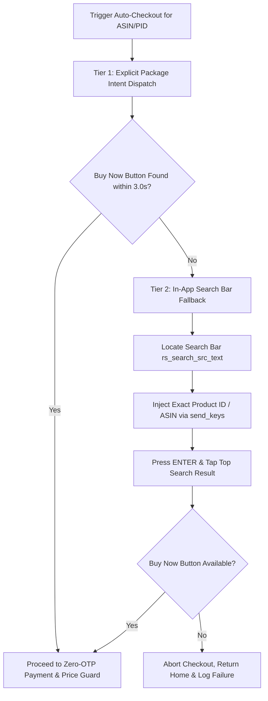

# Flash-Hunter: Autonomous Flash-Sale Hunter & Auto-Checkout Assistant

Autonomous, high-speed flash-sale detection, LLM deal verification, and automated zero-OTP checkout assistant for **Amazon India (`amazon.in`)** and **Flipkart (`flipkart.com`)**.

Engineered for **cross-platform development** on Host Dev Workstations and deployment on resource-constrained **ARM64 edge devices (Xiaomi Mi TV motherboard, 2GB RAM, Native Termux with <200MB RSS footprint)**.

---

## Key Architectural Features

- **Dual-Environment Architecture:**
  - **Dev Host Offline Mode:** Develop, lint, and run 100% offline mocked unit tests with zero Android/ADB hardware dependencies (`DRY_RUN=true`).
  - **On-Board Standalone Mode:** Runs inside Native Termux on the Mi TV motherboard, directly driving local ADB (`127.0.0.1:5555`).
  - **Remote LAN Controller Mode:** Run from your development laptop while controlling the Mi TV board over Wi-Fi/LAN ADB (`<MI_TV_IP>:5555`).
- **Resilient Transport & Anti-WAF:**
  - Primary `curl_cffi` with `chrome124` browser TLS fingerprint impersonation.
  - Automatic fallback to `httpx[http2]` configured with Chrome SSL cipher suites.
- **Fast HTML Parsing:**
  - Sub-millisecond DOM parsing via `selectolax` (with `BeautifulSoup4` + `lxml` fallback).
- **Sub-Millisecond Fast Rule Engine:**
  - Evaluates user expectations (`natural_language_spec`), price caps, discount percentages, and negative keywords (blocking accessories/traps).
  - Global `crazy_deal_override` (e.g., >=90% discount under ₹10,000 across all streams).
- **Cloud LLM Verification:**
  - `gemini-2.5-flash` with strict Pydantic Structured Outputs.
  - Automatic fallback to Groq `llama-3.3-70b-versatile` and offline heuristics.
- **Zero-OTP Automated Checkout & Price Guard:**
  - Supports **Amazon Pay Balance**, **Flipkart Gift Card / Wallet**, and **COD / Pay on Delivery**.
  - **NPCI UPI Excluded:** Avoids Android `FLAG_SECURE` screen capture blocks.
  - **Mandatory Final Price Guard:** Inspects the UI XML hierarchy right before final confirmation; immediately aborts (`d.press("home")`) and alerts if flash prices surged or expired mid-checkout.
- **Financial Safety Circuit Breaker:**
  - Daily spend limits, single-item price caps, post-order kill switches, and concurrency race-condition locks.
- **2-Way Telegram Control:**
  - Real-time Markdown alerts and interactive commands (`/status`, `/pause`, `/resume`, `/kill`, `/reset_kill`).

---

## Active Category Filters & Budget Constraints

Categories are declaratively configured in [`config/targets.yaml`](config/targets.yaml:1) and validated via fast sub-millisecond filtering and cloud LLM verification:

| Category ID | Target Name | Budget Cap (INR) | Min Discount | Key Exclusions / Negative Keywords |
| :--- | :--- | :--- | :--- | :--- |
| `high_end_laptops` | High-End Laptops (Gaming/Ultrabook) | **₹10,000.00** | 50.0% | Celeron, Pentium, Athlon, Chromebook, eMMC, dual-core, skins, cooling pads, laptop bags, spares |
| `pc_components` | PC Components (GPU, CPU, NVMe, RAM) | **₹15,000.00** | 35.0% | Thermal paste, cables, fan splitters, brackets, prebuilts, heatsink-only, empty boxes |
| `large_home_appliances` | Large Appliances (AC, Fridge, TV, Washing Machine) | **₹5,000.00** | 60.0% | Covers, stands, trolleys, inlet pipes, stabilizers, remotes, descaling powder, filters |
| `flagship_smartphone` | Flagship / Upper Mid Smartphone | **₹25,000.00** | 30.0% | Covers, cases, tempered glass, skins, cables, adapters, dummy units, renewed |
| `tws_anc_earbuds` | TWS Earbuds with ANC | **₹4,500.00** | 50.0% | Silicone cases, ear tips, straps, replacement single buds, charging cables |
| `smartwatch_amoled` | AMOLED Smartwatch | **₹2,500.00** | 60.0% | Straps, bands, screen guards, bumpers, charging docks, bezel rings |
| `mechanical_keyboard` | Mechanical Gaming Keyboard | **₹3,000.00** | 45.0% | Keycaps only, wrist rests, switch pullers, lube, switches only, desk mats, membrane |
| *global_rules* | Crazy Deal Loot Override | **₹10,000.00** | 90.0% | Triggers instantly across all streams regardless of category for 90%+ discount items |

---

## Android TV WebView Limitations & 2-Tier Navigation Strategy

### Root Cause of Android TV Deep Link Failures
On headless or leanback Android TV devices (such as Xiaomi Mi TV motherboards running Android TV 9/10/11), standard Android App Links (`https://www.amazon.in/dp/<ASIN>`) frequently fail domain verification or get hijacked by an outdated `com.google.android.webview` provider. When invoked via standard `android.intent.action.VIEW` intents, this can result in:
1. Blank WebView rendering or infinite spinner.
2. In-app browser redirects to login interstitials instead of native shopping screens.
3. System `ResolverActivity` dialogs hanging automated headless execution.

### Implemented 2-Tier Automated Fallback Navigation
Implemented in [`src/checkout/adb_checkout.py`](src/checkout/adb_checkout.py:106):



1. **Tier 1 (Direct Deep Link Intent):**
   Dispatches explicit component intent targeting the retailer package:
   ```bash
   adb shell am start -a android.intent.action.VIEW -d 'https://www.amazon.in/dp/<ASIN>' -p in.amazon.mShop.android.shopping
   ```
2. **Tier 2 (High-Speed In-App ASIN Search Fallback):**
   If the "Buy Now" button is not clickable within 3.0 seconds, `ADBCheckoutDriver` automatically:
   - Locates the in-app search input (`rs_search_src_text` or `chrome_search_hint_src`).
   - Injects the exact ASIN via UIAutomator2 key events (`d.send_keys(product.product_id)`).
   - Submits `ENTER` and clicks the first exact matched listing.

---

## Troubleshooting & ADB Diagnostics

Use the following diagnostic commands from the host machine or local Termux shell to debug intent routing, WebView state, and background permissions:

### 1. Verify Android System WebView Provider
```bash
adb shell dumpsys webviewupdate
```
*Look for `Current WebView package (name, version)` to ensure a valid WebView provider is active.*

### 2. Verify Deep Link Intent Resolution
Check which activity handles the Amazon or Flipkart product URL:
```bash
# Test Amazon ASIN intent resolution
adb shell cmd package resolve-activity --brief -a android.intent.action.VIEW -d "https://www.amazon.in/dp/B0CQPLJPTM"

# Test Flipkart PID intent resolution
adb shell cmd package resolve-activity --brief -a android.intent.action.VIEW -d "https://www.flipkart.com/p/itm?pid=ACCLAPTOP123"
```

### 3. Check App Whitelisting & Doze State
Ensure Termux and shopping applications bypass Android Doze mode:
```bash
adb shell dumpsys deviceidle whitelist | grep -E "termux|amazon|flipkart"
```
To manually whitelist if missing:
```bash
adb shell dumpsys deviceidle whitelist +com.termux
adb shell dumpsys deviceidle whitelist +in.amazon.mShop.android.shopping
adb shell dumpsys deviceidle whitelist +com.flipkart.android
```

### 4. Monitor Live UI Hierarchy During Checkout
Dump the current foreground XML hierarchy to debug missing resource IDs:
```bash
adb shell uiautomator dump /data/local/tmp/uidump.xml && adb shell cat /data/local/tmp/uidump.xml
```

---

## Termux Low-RAM ARM Deployment Checklist

Follow this checklist when deploying to 2GB RAM ARM64/32-bit Android devices:

- [ ] **Termux Architecture:** Verify userland architecture (`uname -m`). On 32-bit userlands, compilation flags must be clamped to single-core to avoid OOM killer during `pip install`:
  ```bash
  export ANDROID_API_LEVEL=24
  export CARGO_BUILD_JOBS=1
  export RUSTFLAGS="-C opt-level=1 -C debuginfo=0"
  ```
- [ ] **Wake-Lock:** Execute `termux-wake-lock` to ensure the CPU does not throttle when the TV display enters standby.
- [ ] **System Dependencies:** Ensure required C libraries for Pillow, Cryptography, and SQLite are installed:
  ```bash
  pkg install -y python python-pip git rust clang binutils libxml2 libxslt libffi openssl sqlite android-tools make pkg-config libjpeg-turbo libpng freetype libwebp openjpeg
  ```
- [ ] **Target Virtualenv:** Initialize python environment using `--system-site-packages` to leverage precompiled Termux binaries.
- [ ] **Memory Watchdog:** Confirm [`scripts/start_hunter_termux.sh`](scripts/start_hunter_termux.sh:1) is running with RSS ceiling set to `<190MB` (`MAX_RSS_KB=194560`).
- [ ] **Configuration Check:** Verify [`config/settings.yaml`](config/settings.yaml:1) has `dry_run: true` until live test runs confirm stable execution.

---

## Repository Structure

```text
flash-hunter/
├── AGENTS.md                      # Target hardware constraints & guardrails
├── PROJECT_CONTEXT.md             # Complete architectural context & state
├── README.md                      # Documentation & deployment guide
├── requirements.txt               # Pinned cross-platform dependencies
├── pytest.ini                     # Pytest runner configuration
├── .context                       # Machine-readable project state JSON
├── .env.example                   # Environment configuration template
├── .stignore                      # Syncthing ignore patterns (.venv, *.db, cache)
├── config/
│   ├── settings.yaml              # Global budget, notifications, & bot settings
│   └── targets.yaml               # Target categories, NL specs & crazy deal rules
├── scripts/
│   ├── bootstrap_termux_target.sh # Target Termux setup (run ONLY on Mi TV)
│   ├── start_hunter_termux.sh     # Target watchdog supervisor (<200MB RSS)
│   └── deploy_to_board.sh         # Host machine Rsync/SSH deployment script
├── src/
│   ├── __init__.py
│   ├── main.py                    # Asyncio orchestrator & deal worker pool
│   ├── config_loader.py           # Pydantic v2 settings & YAML target loader
│   ├── db/
│   │   └── state_store.py         # aiosqlite WAL store (dedup, orders, audit)
│   ├── transport/
│   │   └── http_client.py         # curl_cffi + httpx[http2] resilient transport
│   ├── ingestion/
│   │   ├── telegram_stream.py     # Telethon listener & URL unshortener
│   │   └── category_poller.py     # Jittered async category poller
│   ├── scraper/
│   │   └── product_fetcher.py     # selectolax parser (Amazon ASIN / Flipkart PID)
│   ├── filter/
│   │   └── rule_engine.py         # Sub-millisecond filter & crazy deal evaluator
│   ├── intelligence/
│   │   └── llm_validator.py       # Gemini 2.5 Flash + Groq fallback
│   ├── checkout/
│   │   ├── base.py                # Abstract CheckoutDriver interface
│   │   ├── adb_checkout.py        # uiautomator2 + deep link zero-OTP checkout
│   │   ├── lan_webhook.py         # Signed HMAC-SHA256 webhook driver
│   │   └── mock_checkout.py       # Mock driver for host offline testing
│   ├── safety/
│   │   └── circuit_breaker.py     # Budget caps, race locks, & kill switches
│   └── notifier/
│       └── telegram_bot.py        # 2-way Telegram notification & control bot
└── tests/
    ├── fixtures/
    │   ├── amazon_product_sample.html
    │   └── flipkart_product_sample.html
    ├── test_adb_checkout_mocked.py
    ├── test_circuit_breaker.py
    ├── test_config_settings.py
    ├── test_llm_validator.py
    ├── test_rule_engine.py
    └── test_scraper_parsers.py
```

---

## Local Development & Testing (Host Machine)

### 1. Setup Virtual Environment
```bash
python3 -m venv .venv
source .venv/bin/activate
pip install -r requirements.txt
```

### 2. Configure Environment
```bash
cp .env.example .env
# Edit .env with your Telegram, Gemini/Groq, and target configurations
```

### 3. Run Unit Tests (100% Mocked / Offline)
```bash
./.venv/bin/pytest -v
```

---

## Deployment to Xiaomi Mi TV Board (ARM64 Termux)

### 1. Synchronize Code to Board via SSH / Rsync
From your host machine:
```bash
bash scripts/deploy_to_board.sh <MI_TV_IP> 8022 <TERMUX_USER>
```

### 2. Bootstrap Target Environment (First Time Only)
On the Mi TV Termux terminal:
```bash
bash ~/flash-hunter/scripts/bootstrap_termux_target.sh
```

### 3. Start Watchdog Supervisor
On the Mi TV Termux terminal:
```bash
nohup bash ~/flash-hunter/scripts/start_hunter_termux.sh > /dev/null 2>&1 &
```
